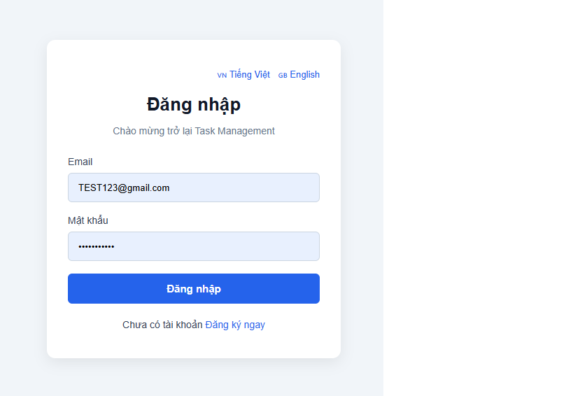
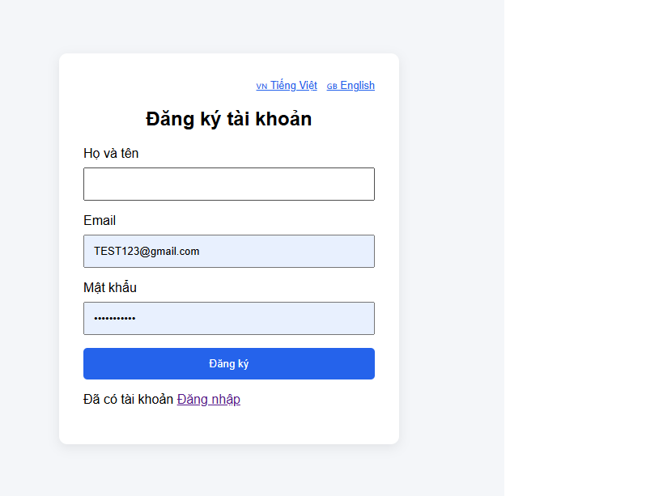
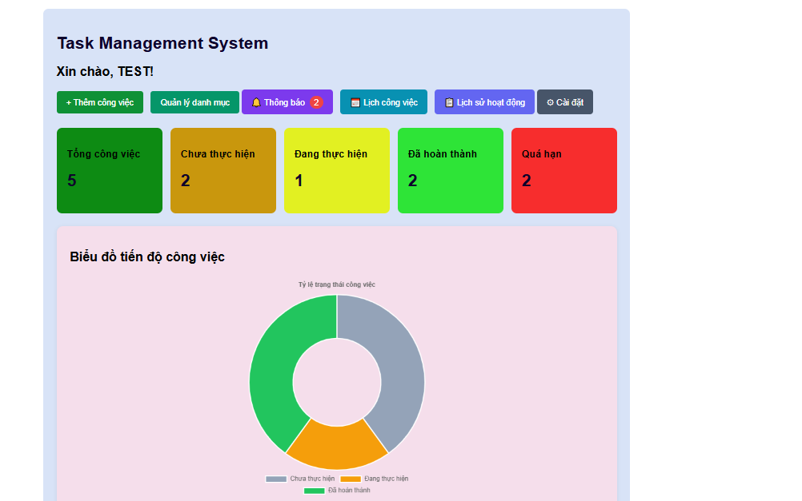

# Task Management System

**Hệ thống quản lý công việc cá nhân – Dự án thực tập**

Task Management System là ứng dụng web hỗ trợ người dùng quản lý công việc, danh mục, lịch làm việc và theo dõi tiến độ hoàn thành.

Dự án được xây dựng trong quá trình thực tập tại Trung tâm phát triển phần mềm.

## Công nghệ sử dụng

| Thành phần | Công nghệ |
|---|---|
| Ngôn ngữ | Java 17 |
| Backend | Spring Boot 4.0.8 |
| Bảo mật | Spring Security, BCrypt |
| Database | MySQL |
| ORM | Spring Data JPA, Hibernate |
| Frontend | Thymeleaf, HTML, CSS, JavaScript |
| Biểu đồ | Chart.js |
| Công cụ | Maven, VS Code, Git, GitHub |

## Chức năng chính

### Người dùng (USER)

- Đăng ký, đăng nhập, đăng xuất.
- Quản lý hồ sơ cá nhân và đổi mật khẩu.
- Thêm, sửa, xóa và tìm kiếm công việc.
- Lọc công việc theo trạng thái, độ ưu tiên.
- Quản lý danh mục công việc.
- Theo dõi công việc trên lịch.
- Thống kê và hiển thị biểu đồ.
- Nhận thông báo công việc sắp đến hạn và quá hạn.
- Xem nhật ký hoạt động.
- Cài đặt giao diện sáng/tối và bật/tắt thông báo.
- Xóa tài khoản cá nhân.

### Quản trị viên (ADMIN)

- Truy cập Admin Dashboard.
- Xem thống kê tổng quan hệ thống.
- Xem danh sách tài khoản.
- Tìm kiếm người dùng theo tên hoặc email.
- Kiểm soát quyền truy cập bằng Spring Security.

## Cơ sở dữ liệu

Database: `task_management_db`

Gồm 6 bảng:

- `users`
- `tasks`
- `categories`
- `notifications`
- `activity_logs`
- `settings`

## Cài đặt và chạy dự án

**Yêu cầu:** Java 17, MySQL và Git.

### 1. Clone mã nguồn

```bash
git clone https://github.com/USERNAME/task-management-system.git
cd task-management-system
```

Thay `USERNAME` bằng tên GitHub thực tế.

### 2. Chuẩn bị MySQL

Tạo database:

```sql
CREATE DATABASE task_management_db
CHARACTER SET utf8mb4
COLLATE utf8mb4_unicode_ci;
```

Database cần được khởi tạo đầy đủ các bảng theo schema của dự án vì Hibernate hiện sử dụng `ddl-auto=validate`. File SQL cấu trúc sẽ được bổ sung sau.

### 3. Cấu hình kết nối

Trong `application.properties`, thông tin đăng nhập được đọc từ biến môi trường:

```properties
spring.datasource.username=${DB_USERNAME:root}
spring.datasource.password=${DB_PASSWORD:}
```

Thiết lập các biến môi trường phù hợp với tài khoản MySQL trên máy.

### 4. Khởi động ứng dụng

Trên Windows:

```powershell
.\mvnw.cmd spring-boot:run
```

Truy cập: http://localhost:8080/login

## Cấu trúc dự án

```text
src/main/java/com/taskmanagement/
├── config/
├── controller/
├── dto/
├── entity/
├── repository/
└── service/

src/main/resources/
├── templates/
├── application.properties
├── messages.properties
├── messages_vi.properties
└── messages_en.properties
```

## Trạng thái dự án

**Đã hoàn thành:** Các chức năng quản lý công việc, danh mục, tài khoản, thống kê, lịch, thông báo, nhật ký và quản trị hệ thống.

**Đang hoàn thiện:** Chuyển đổi ngôn ngữ Việt/Anh toàn hệ thống, tài liệu dự án và kiểm thử tổng thể.

## Tài liệu thực tập

Các tài liệu SRS, Use Case, UML, thiết kế database và kiểm thử sẽ được bổ sung trong thư mục `docs/`.

## Mục đích

Dự án phục vụ mục đích học tập, thực tập và nghiên cứu phát triển phần mềm.


## Hình ảnh giao diện

### Trang đăng nhập



### Trang đăng ký



### Dashboard


